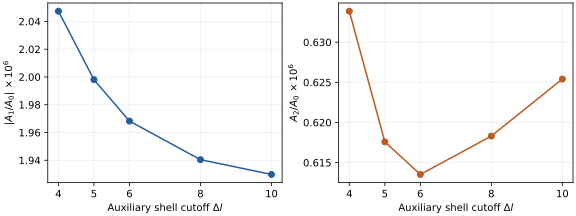

# Matched-boundary tests

The new calculation compares the full intertwiner amplitude in two fixed-spin
boundary sectors, not only three homogeneous intertwiner probes. A precise
SU(2) boundary embedding is implemented and checked. Its unused degrees of
freedom are in the j=0 kinematical vacuum; it is not a dynamically selected
vacuum or a nondegenerate fine geometry.

The separate homogeneous-boundary shell scan extends the numerical-cutoff
study on the original 16-cell block. Increasing that cutoff does not refine
the spacetime complex.

## A concrete boundary map

The boundary graph of one four-simplex is K5. We find a routed copy of K5 on
the fine boundary. Each original node stays within its inherited tetrahedron
patch; each original link crosses its inherited triangle exactly once.
Distinct routes have no common internal nodes or edges.

Put the old spin j on each segment of these paths and j=0 on every unused
link. A node inserted along a path has the normalized bivalent invariant.
At each of the five original nodes an explicitly computed orthogonal matrix
converts the fine coupling basis to the original sorted-face basis.
The epsilon-metric signs are computed, including for half-integer spins.

In terms of holonomies, the definition is

```math
(\iota\psi)(\{g_e\})=\psi\!\left(\left\{\prod_{e\in P_l}g_e^{\pm1}\right\}\right).
```

The sign of the exponent is fixed by the direction along the path. This is an
isometry for normalized Haar measure: every coarse link has a unique fine
carrier, and integrating over it is Haar integration over the corresponding
coarse holonomy. All other normalized Haar integrals give one. This argument
applies to the whole coarse Hilbert space, beyond the finite numerical probes.

Tests evaluate both sides independently using magnetic indices at random
SU(2) holonomies. The fine and coarse node tensors, edge normalization and
holonomy products are assembled independently. Local basis matrices are also
checked for orthogonality. Both tests include j=1/2 and j=1.

The two tested triangulations are a single boundary-edge bisection (1->2 cells)
and our actual edgewise 1->16 block. For each we construct two different maps
by reversing a deterministic routing search. They are different choices of
embedding, not two numerical evaluations of the same fine state.

| Boundary | Nonzero links, map A | Nonzero links, map B | Total links |
|---|---:|---:|---:|
| 2 cells | 13 | 13 | 16 |
| 16 cells | 25 | 37 | 80 |

The ten inherited triangle areas are exactly the original ones: each has one
nonzero fine carrier. All inserted boundary nodes are bivalent or carry only
zero spins; their volume vanishes. Thus this is an exact kinematical comparison
and an implementation test. It does not solve how to place newly resolved
degrees of freedom in the physical vacuum.

Matching an additive area alone is insufficient. For example, four spin-1/2
pieces have the same summed area as one spin-3 triangle:

```math
4\sqrt{\tfrac12(\tfrac12+1)}=\sqrt{3(3+1)}.
```

However, four spin-1/2 representations couple only to total J=0,1,2, never 3.
This example fails a coarse-flux matching condition despite matching that
additive area. It does not rule out superpositions, different coarse observables
or a semiclassical construction with controlled quantum fluctuations.

## Full amplitudes and gluing validation

All internal spins and intertwiners are included. For every internal face in
these examples there is a tetrahedron whose other three faces are boundary
faces. Angular-momentum addition gives a proved finite bound, namely the sum
of those three boundary spins. The evaluator enumerates doubled labels with
unit steps, so half-integer sectors are included from the start. Admissibility
propagation removes only values with no local tetrahedral support. The full
network contraction enforces the remaining correlations exactly.

The evaluator refuses a complex for which it has no proved finite bound;
the internal 1->5 subdivision is an explicit negative test. It does not reuse
the 16-cell bound on a different topology.

For each fixed boundary-spin sector the five coarse intertwiner indices remain
open: 2^5=32 coefficients for j=1/2, and 3^5=243 for j=1. On the 16-cell block,
map A has fixed internal spins after admissibility propagation. Map B retains
nontrivial sums: for j=1/2 its five domains are {0,1}, {1/2}, {0,1},
{1/2,3/2}, {1/2,3/2}; for j=1 they are {0,1,2}, {1}, {0,1,2},
{0,1,2,3}, {0,1,2,3}. These are physical spins, not doubled input labels.

Normalized native BF vertices are used as an independent gluing reference.
All eight fine BF functionals must equal the corresponding coarse functional,
including its normalization and signs. The magnetic single-vertex convention
checks also run. Failure stops the EPRL campaign. BF is a convention check;
the measured gravitational amplitudes use the full Lorentzian EPRL vertex.

Half-integer signs are derived by following each magnetic strand. An internal
face closes to an identity metric; a boundary face ends in the canonical
epsilon metric. Reversing an epsilon contributes (-1)^(2j), and
epsilon_j^2=(-1)^(2j)I. These signs are unity for integer spins, recovering
the earlier benchmark convention. No unvalidated half-integer orientation
rule is inferred from array dimensions alone.

Conventions: gamma=1.2, native VERYHIGH accuracy, rho=gamma*(j+1), unit edge
weight, one internal face factor 2j+1, and sqrt(2j+1) per boundary link. The
last factor makes the spin-network normalization explicit for changing boundary
graphs. Earlier homogeneous-boundary reports omitted boundary factors; their
within-graph ratios are unaffected. Results here refer to these conventions,
not to every EPRL variant.

Two independently chosen exact contraction orders check every functional.
Output tensors and all admissible labels are retained; no tensor compression
or geometric restriction of bulk configurations is used.

## What is measured

For a coarse amplitude vector C and pulled-back fine vector F, report

```math
\epsilon=\min_{c\in\mathbb R}\frac{\|F-cC\|_2}{\|F\|_2}.
```

Only one scalar c is removed for the entire fixed-spin boundary sector.
The calculation is not changed, and no separate fit is made for each state.
The driver also records the signed coefficient vectors and their logarithmic
scales, normalized overlaps, norm ratios, cutoff changes and comparisons
between the two maps. A small global residual does not bound the fractional
error of an individual coefficient close to zero.

## Finite-shell measurements and incomplete runtime record

The complete initial shell-zero snapshot is
[`2026-10-18-matched-boundary-pilot.json`](../benchmarks/results/2026-10-18-matched-boundary-pilot.json).
It includes all eight fine BF comparisons and eight EPRL comparisons.

The extended campaign requested 32 EPRL comparisons: two boundary spins, two
triangulations, two maps, and auxiliary shell cutoffs 0,2,4,8. Its running report
confirmed 31 completed comparisons before the execution service disconnected.
Both fresh process creation and access to the existing job sessions then failed.
The last comparison, j=1 with 16-cell map B at shell 8, has **unverified
completion**. This is an infrastructure interruption, not a computed failure of
the amplitude or a physical divergence.

The confirmed shell-8 summaries are recorded in
[`2026-10-18-matched-boundary-observed-summary.json`](../benchmarks/results/2026-10-18-matched-boundary-observed-summary.json).
All table entries below are the residual in percent after removing one global
scalar for the whole coarse boundary sector:

| Boundary spin | Local split A | Local split B | 16-cell map A | 16-cell map B |
|---|---:|---:|---:|---:|
| j=1/2 | <1e-9% | 0.0896035% | 0.0896035% | 92.9915% |
| j=1 | 5.58914% | 5.24236% | 22.1756% | completion unverified |

The initial shell-zero residuals for j=1 were 2.94751%, 2.94751%, 18.3462%
and 84.4313%, respectively. Thus more accurate auxiliary sums do not
automatically make a bare refinement agree with the coarse amplitude.

For j=1 map A on 16 cells, the normalized fine vector changes by 1.53229%
from shell 4 to 8, whereas its shell-8 coarse/fine residual is 22.1756%.
These are finite-cutoff diagnostics, not certified estimates of the remaining
shell tail. The strong dependence on the embedding choice should not be
interpreted as a proof against a continuum limit.

Random-holonomy pullback discrepancies are at most 6.7e-15. The largest
scale-free BF residual is 2.6e-15; absolute normalization is checked too.
The 11 default and two new automated checks passed, including half-integer
gluing and finite-spin completeness on the tested complexes.

The planned cache-only replay of the extended campaign and retrieval of its
final raw report could not be completed. The initial snapshot contains full
signed coefficient vectors; for the higher-shell extension only the
console-confirmed summary metrics were recovered. No missing coefficients or
last-case result have been reconstructed or invented.

## Homogeneous-boundary shell extension

The original all-boundary-j=1, K=3 calculation completes at shell cutoff 10.
The raw result is saved in
[`2026-10-18-shell10.json`](../benchmarks/results/2026-10-18-shell10.json).
This is a separate boundary prescription from the matched-state tests above.
All physical internal spins and intertwiners are summed; only the auxiliary
shell sum remains truncated.

| Shell cutoff | A1/A0 | A2/A0 |
|---:|---:|---:|
| 6 | -1.9682335293e-6 | 6.1352365569e-7 |
| 8 | -1.9404319812e-6 | 6.1831161322e-7 |
| 10 | -1.9297994008e-6 | 6.2541474552e-7 |

From shell 8 to 10, the magnitude of the first ratio decreases 0.54795%,
the second increases 1.14879%, and the raw magnitude of A1 increases 11.4019%.
The second ratio's latest fractional change is larger than its 0.78040%
change from shell 6 to 8. There is no justified simple monotonic tail fit or
certified sub-percent accuracy for both ratios.



Lines connect completed finite-cutoff calculations; they are guides to the eye,
not extrapolations. No tail-error bars are available.

All 574 ordered vertices at shell 10 were computed in 2523.27 seconds of
preparation, using one process and four requested OpenMP threads. The three
amplitudes each agree under two exact contraction orders. This is a local
timing with another native campaign running concurrently, not an isolated
hardware benchmark. Shell 12 was started with a 2700-second budget. The last filesystem check
found 15 completed vertices. Its completion or time-limit outcome could not
be verified after the execution-service disconnect, and no shell-12 amplitude
is claimed.

## Zero-spin convention control

The j=0 embeddings make the Y-map convention particularly relevant. The
default sl2cfoam-next build uses rho=gamma*(j+1); upstream also exposes a
rho=gamma*j build flag. Perez's
[review](https://pmc.ncbi.nlm.nih.gov/articles/PMC5255902/), under the Lorentzian
Master-constraint criterion,
explicitly discusses the zero-spin cylindrical-consistency issue associated
with the former choice. This is a reason to check conventions before assigning
physical significance to an embedding discrepancy.

We built the second convention in a separate pinned upstream checkout, with
the same dependencies, without altering the active default library. Both
builds compute the all-j=1/2 vertex at shell zero. The default also computes
the all-j=0 vertex. The alternative aborts on j=0: upstream `src/dsmall.c`
explicitly refuses rho=0. The four smoke-test outcomes are saved in
`benchmarks/results/2026-10-18-zero-spin-conventions.json`.

Consequently, this campaign does **not** compare matched refinement amplitudes
between the two conventions. A specification and implementation of the zero-spin
treatment is needed first. The native abort is an implementation limitation,
not a computed physical divergence. Replacing zero by a small nonzero rho
would change the calculation and has not been done.

## Interpretation and next calculation

The map is exact at the kinematical level. It need not preserve the bare EPRL
amplitude. Dependence on these two maps is evidence about this initial choice
of fine vacuum and these amplitudes; it is not proof that EPRL has no continuum
limit, or that edgewise refinement is unsuitable.

A continuum study still needs a choice of coarse observables, a physically
motivated state for the new degrees of freedom, and an effective amplitude
that can change under elimination of fine variables. Those choices should be
tested on boundary probes not used to construct them. A fitted normalization
for every state would remove the very discrepancy being tested.

This distinction between kinematical and dynamical embeddings is discussed in
Asante, Dittrich & Steinhaus, [arXiv:2211.09578](https://arxiv.org/abs/2211.09578),
section 5, especially equations 15-18 and the discussion following equation 18.
The area convention is from Rovelli,
[arXiv:1102.3660v5](https://arxiv.org/abs/1102.3660), equations 37-38.

## Reproduce

Install `benchmarks/requirements.txt` and configure the native backend as in
`docs/setup.md`. One native-library instance is used per Python invocation.

```bash
export OPENBLAS_NUM_THREADS=1 MKL_NUM_THREADS=1 OMP_NUM_THREADS=1
python -m unittest benchmarks.test_matched_boundary -v
python -m benchmarks.matched_boundary --run runs/matched-new \
  --output benchmarks/results/matched-new.json --dl 0 2 4 8
```

The same run directory reuses complete ordered native tensors. Its cache
entries retain the strict binary/table identity locally. Public reports export
scientific inputs, source revisions and results without host/build diagnostics.
`--two-j 1` selects physical j=1/2; `--two-j 2` selects j=1. `--kinds split`
runs only the smallest local comparison. The default runs both triangulations,
both maps and both spins. Assembly and contraction are exact at each finite
auxiliary shell cutoff; no remaining shell-tail error is certified.

Extend the original homogeneous-boundary scan separately:

```bash
python -m benchmarks.block_scan --run runs/shell-states-existing --cutoff 3 \
  --dl 10 12 --processes 1 --threads 4 --timeout 2700 \
  --output benchmarks/results/shell10-12-new.json
```

Use the same numerical backend and tables as the existing cache. Preserve each
attempt's report if a case reaches its time budget. A resource limit supplies
no amplitude estimate. No INFN jobs are submitted by these commands.

For the convention smoke test, first build separate upstream checkouts and
select their libraries explicitly:

```bash
python -m benchmarks.check_zero_spin \
  --libraries /path/to/default/lib/libsl2cfoam.so /path/to/gj/lib/libsl2cfoam.so \
  --output benchmarks/results/zero-spin-conventions-new.json
```

The alternate build command is documented in `docs/setup.md`. A reported
`unsupported` case is a recorded backend limitation, not a successful amplitude.
